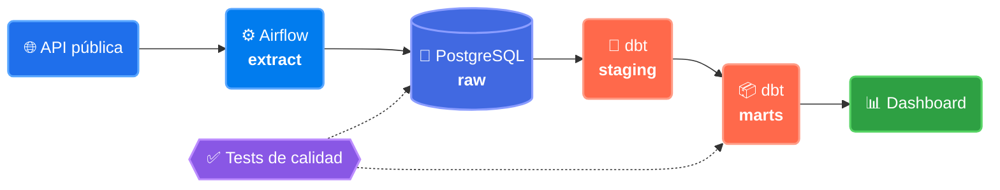

# Hernán Peinetti

### Data Engineer · Python · SQL · Airflow

**Construyo pipelines que corren solos y en los que se puede confiar.**
Ingesta desde APIs y archivos, validación de calidad, modelado en capas y orquestación diaria.

📍 Argentina · 🟢 Disponible para trabajar · 🌎 Remoto

---

## 🎯 Proyecto destacado

### [Pipeline de datos end-to-end →](https://github.com/HernanPeinetti/NOMBRE-DEL-REPO)

*De una API pública a un dashboard confiable, sin tocar nada a mano.*

<!-- GIF del DAG corriendo en Airflow. Esto es lo que más impacta: descomentalo cuando lo tengas.

-->

<table>
<tr>
<td align="center"><b>50k</b> filas / día</td>
<td align="center"><b>~3 min</b> por corrida</td>
<td align="center"><b>12</b> tests de calidad</td>
<td align="center"><b>100%</b> idempotente</td>
<td align="center"><b>1</b> comando para levantarlo</td>
</tr>
</table>

**Los tres problemas que tuve que resolver:**

| Problema | Cómo lo resolví |
|---|---|
| La API falla de forma intermitente | Reintentos con backoff exponencial; el DAG no se cae ni pierde la ventana del día |
| Re-ejecutar duplicaba datos | Carga idempotente con *merge* por clave natural; correrlo dos veces da el mismo resultado |
| Datos malos llegaban al dashboard | 12 tests de dbt (nulos, duplicados, rangos, integridad referencial) que frenan la publicación |

---

## 📦 Otros proyectos

<table>
<tr>
<td width="50%" valign="top">

### ⚙️ [ETL Pipeline](https://github.com/HernanPeinetti/etl-pipeline)
Extrae de archivo o API, valida calidad y carga en un esquema documentado en PostgreSQL.

`Python` `Pandas` `SQL` `PostgreSQL`

</td>
<td width="50%" valign="top">

### 🔄 [Airflow Orchestration](https://github.com/HernanPeinetti/airflow-data-orchestration)
DAG que consume una API pública a diario y la persiste en PostgreSQL, todo con Docker Compose.

`Airflow` `Python` `Docker`

</td>
</tr>
<tr>
<td width="50%" valign="top">

### 🐳 [Docker + CI Starter](https://github.com/HernanPeinetti/docker-starter)
App containerizada con tests y despliegue automatizado vía GitHub Actions.

`Docker` `GitHub Actions` `Linux`

</td>
<td width="50%" valign="top">

### 🖥️ [SysOps Automation](https://github.com/HernanPeinetti/sysops-automation)
Scripts de backup, rotación de logs y alertas de disco, programados con cron.

`Bash` `Linux` `Cron`

</td>
</tr>
</table>

---

## 🧰 Stack

**Datos**

**Infra y DevOps**

**Desarrollo** *(experiencia previa)*

---

## 📐 Cómo trabajo

> **Idempotencia primero.** Un pipeline que se re-ejecuta no debería duplicar nada.
>
> **Validar antes de cargar.** Los datos malos se detectan en el pipeline, no en el dashboard.
>
> **Un comando para levantarlo.** Si otra persona no lo puede correr, no está terminado.
>
> **Documentar la decisión, no solo el código.** El README explica *por qué*, no solo *cómo*.

---

## 🌱 Aprendiendo ahora

`PySpark` · `AWS (S3, Glue, Redshift)` · `Modelado dimensional avanzado` · `Testing de datos con Great Expectations`

---

### ¿Buscás a alguien para tu equipo de datos?

Estoy abierto a oportunidades como Data Engineer junior.

