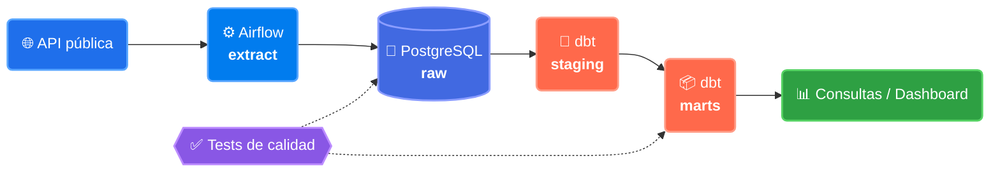

# Hernán Peinetti

### Data Engineer Jr. · Python · SQL · Airflow

**Armo pipelines de datos reproducibles: ingesta, validación, modelado y orquestación.**
Vengo del desarrollo web y me especialicé en datos. Busco mi primer rol en un equipo de datos.

📍 Argentina · 🟢 Disponible · 🌎 Remoto o híbrido · 🗣️ Español · Inglés TU-NIVEL

---

## 👋 Sobre mí

Trabajé como desarrollador web y en ese camino descubrí que lo que más me interesaba era la parte de atrás: de dónde vienen los datos, cómo se mueven entre sistemas y por qué a veces no se puede confiar en ellos. Así que me formé en ingeniería de datos y hoy construyo pipelines completos.

Estoy arrancando en el rubro, y eso significa dos cosas: todavía tengo mucho por aprender, y aprendo rápido porque estoy metido en esto todos los días. Lo que sí traigo es la costumbre de escribir código ordenado, documentar lo que hago y trabajar con Git como corresponde.

**Lo que busco:** un equipo donde pueda sumar desde el primer día en tareas de ingesta, transformación y calidad de datos, y donde haya gente con más experiencia de la que aprender.

---

## 🎯 Proyecto principal

### [Pipeline de datos end-to-end →](https://github.com/HernanPeinetti/NOMBRE-DEL-REPO)

*De una API pública a tablas listas para analizar, orquestado y testeado.*

<!-- Cuando lo tengas corriendo, grabá un GIF del DAG en Airflow y descomentá esto.
     Es lo que más impacto genera en un recruiter técnico.

-->

**Qué hace cada pieza**

| Etapa | Qué resuelve |
|---|---|
| **Extracción** | Un DAG de Airflow consulta la API todos los días, con reintentos ante fallas de red |
| **Capa raw** | Guarda el dato tal cual llegó, sin transformar, para poder reprocesar si algo sale mal |
| **Transformación** | Modelos dbt en dos capas: staging limpia y tipa, marts arma las tablas de negocio |
| **Calidad** | Tests que frenan la publicación si aparecen nulos, duplicados o valores fuera de rango |
| **Infraestructura** | Todo levanta con `docker compose up`, para que cualquiera lo pueda correr |

**Qué aprendí construyéndolo**

- Por qué un pipeline tiene que ser **idempotente**: la primera versión duplicaba filas al re-ejecutarla, y lo resolví con carga por clave natural
- Que **guardar el dato crudo** te salva: cuando cambié el modelado, pude reprocesar todo sin volver a pegarle a la API
- Que los tests de datos atrapan errores que los tests de código no ven

---

## 📦 Otros proyectos

<table>
<tr>
<td width="50%" valign="top">

### ⚙️ [ETL Pipeline](https://github.com/HernanPeinetti/etl-pipeline)

Extrae datos de un archivo o API, valida calidad y los carga en un esquema documentado.

**Lo interesante:** separa extracción, validación y carga en módulos testeables por separado.

`Python` `Pandas` `SQL` `PostgreSQL`

</td>
<td width="50%" valign="top">

### 🧪 [Data Quality Checks](https://github.com/HernanPeinetti/NOMBRE-DEL-REPO)

Suite reutilizable de validaciones: nulos, duplicados, rangos, formatos y frescura del dato.

**Lo interesante:** se configura por YAML, así que sirve para cualquier tabla sin tocar código.

`Python` `SQL` `pytest`

</td>
</tr>
<tr>
<td width="50%" valign="top">

### 📊 [Análisis de datos abiertos](https://github.com/HernanPeinetti/NOMBRE-DEL-REPO)

Ingesta de un dataset público, modelado en PostgreSQL y consultas que responden preguntas concretas.

**Lo interesante:** muestra el SQL, no solo el resultado. Ventanas, CTEs y agregaciones.

`SQL` `PostgreSQL` `Python`

</td>
<td width="50%" valign="top">

### 🐳 [Entorno reproducible](https://github.com/HernanPeinetti/docker-starter)

Plantilla con Docker Compose y GitHub Actions que uso como base para arrancar proyectos.

**Lo interesante:** tests y linter corriendo en CI desde el primer commit.

`Docker` `GitHub Actions` `Linux`

</td>
</tr>
</table>

---

## 🧰 Stack

**Lenguajes y datos**

**Orquestación y transformación**

**Entorno de trabajo**

---

## 📐 Cómo trabajo

> **Idempotencia primero.** Un pipeline que se re-ejecuta no debería duplicar nada.
>
> **Validar antes de cargar.** Los datos malos se detectan en el pipeline, no en el dashboard.
>
> **Un comando para levantarlo.** Si otra persona no lo puede correr, no está terminado.
>
> **Documentar la decisión, no solo el código.** El README explica *por qué*, no solo *cómo*.
>
> **Preguntar temprano.** Prefiero consultar una duda hoy que rehacer el trabajo la semana que viene.

---

## 🌱 En qué estoy ahora

| Tema | Estado |
|---|---|
| Modelado dimensional (hechos y dimensiones) | 🟢 Aplicándolo en proyectos |
| Testing de datos con Great Expectations | 🟡 En curso |
| PySpark | 🟡 En curso |
| AWS (S3, Glue, Redshift) | 🔵 Siguiente en la lista |

Antes de datos trabajé como desarrollador web con JavaScript, Node.js, React y MySQL. De ahí traigo la base de SQL y la costumbre de trabajar en equipo con Git.

---

### ¿Buscás a alguien junior con ganas para tu equipo de datos?

Estoy disponible y con muchas ganas de sumarme a un equipo donde pueda aportar y crecer.

