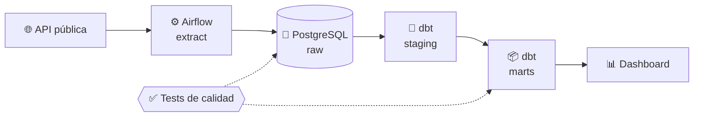

# Hernán Peinetti · Data Engineer

Construyo pipelines de datos confiables: extraigo de APIs y archivos, valido y transformo con Python y SQL, y cargo en bases de datos listas para análisis. Todo orquestado con Airflow, empaquetado con Docker y testeado en CI.

📍 Argentina · 🎯 Buscando mi primer rol como Data Engineer

---

## ⭐ Proyecto destacado

### [Pipeline de datos end-to-end](https://github.com/HernanPeinetti/NOMBRE-DEL-REPO)

> Pipeline diario que ingiere datos de una API pública, los valida, los modela en capas (raw → staging → marts) y los deja listos para un dashboard.

- **Orquestación:** DAG en Airflow con reintentos, backfill e idempotencia
- **Calidad:** tests de nulos, duplicados, rangos y relaciones antes de publicar
- **Modelado:** esquema estrella con tablas de hechos y dimensiones
- **Infra:** todo se levanta con un `docker compose up`; CI con GitHub Actions

`Python` `SQL` `Airflow` `dbt` `PostgreSQL` `Docker` `GitHub Actions`

---

## 🛠️ Proyectos

| Proyecto | Qué resuelve | Stack |
|---|---|---|
| [ETL Pipeline](https://github.com/HernanPeinetti/etl-pipeline) | Extrae de archivo/API, valida calidad (nulos, duplicados, formatos) y carga en un esquema documentado | Python · Pandas · PostgreSQL |
| [Airflow Orchestration](https://github.com/HernanPeinetti/airflow-data-orchestration) | DAG que consume una API pública a diario y la persiste en PostgreSQL | Airflow · Python · Docker |
| [Docker + CI Starter](https://github.com/HernanPeinetti/docker-starter) | App containerizada con tests y deploy automatizado | Docker · GitHub Actions |
| [SysOps Automation](https://github.com/HernanPeinetti/sysops-automation) | Backups, rotación de logs y alertas de disco programados con cron | Bash · Linux · Cron |

---

## 🧰 Stack

**Datos:**

**Infra y DevOps:**

**También trabajé con:** JavaScript, Node.js, React, MySQL (experiencia previa como desarrollador)

**Aprendiendo ahora:** PySpark · AWS/GCP · data warehouses en la nube

---

## 📐 Cómo trabajo

- **Idempotencia primero:** un pipeline que se re-ejecuta no debería duplicar datos
- **Validar antes de cargar:** los datos malos se detectan en el pipeline, no en el dashboard
- **Reproducible:** cada proyecto se levanta con un comando y tiene instrucciones claras
- **Documentado:** README con arquitectura, decisiones y cómo correrlo

---

💬 ¿Tenés un equipo de datos y buscás a alguien con ganas de aportar? [Escribime](mailto:TU-EMAIL).
